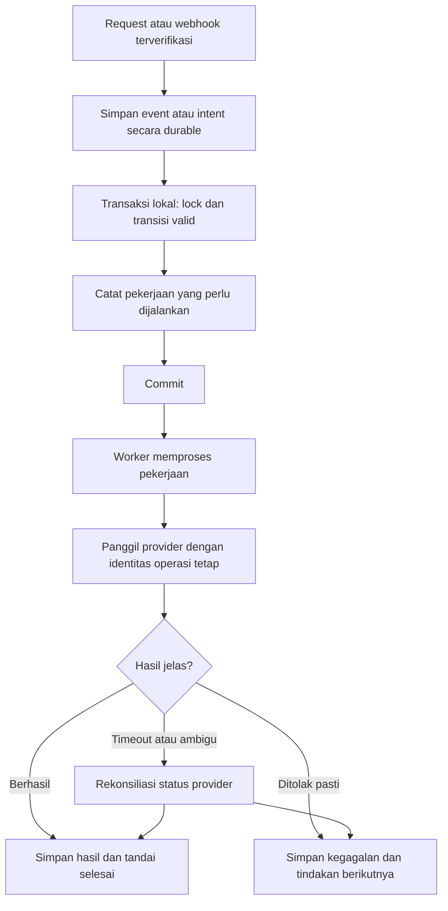

# Rencana penyempurnaan Catkuji

> Pembaruan 23 September 2026: perbaikan autentikasi, pembayaran, dependensi, migrasi, dan tes telah diterapkan. Lihat [audit dan daftar perubahan terbaru](AUDIT-DAN-PERBAIKAN-2026-09-23.md). Uraian bertanggal 17 September di bawah adalah snapshot sebelum perbaikan tersebut.

Tanggal: 17 September 2026. Status: **usulan desain, belum diterapkan**.

Dokumen pasangan: [peta teknis dan skema saat ini](TEKNIS-PROJECT.md), [audit keamanan dan integritas](../AUDIT-2026-09-15.md).

## 1. Arah yang disarankan

Pertahankan Laravel + Vue/Inertia sebagai satu aplikasi, dengan modul bisnis yang batas tanggung jawabnya jelas. Struktur ini cocok untuk memperbaiki transaksi lintas wallet, stok, hadiah, dan inventory dalam satu database.

Belum ada hasil pengukuran trafik yang menjadi dasar untuk memecah layanan atau menambah banyak infrastruktur. Prioritasnya adalah kebenaran transaksi, pemulihan ketika provider bermasalah, dan kemudahan pengoperasian. Redis, penyimpanan objek, atau pemisahan proses dapat ditambahkan saat kebutuhannya terukur.

Hasil yang ingin dicapai:

- Pengguna tidak kehilangan saldo atau hadiah karena klik ulang, timeout, atau callback berulang.
- Admin dapat memahami status, menyelesaikan kasus gagal, dan menelusuri perubahan.
- Tim dapat memperbaiki satu modul dengan tes yang menunjukkan dampaknya terhadap modul lain.
- Angka pembayaran, saldo, stok, dan laporan dapat direkonsiliasi.

## 2. Pembagian modul target

| Modul | Tanggung jawab | Batas yang dijaga |
| --- | --- | --- |
| Identity | Registrasi, OTP, OAuth, status akun, role, session | Modul lain memakai hasil otorisasi; tidak membuat jalur login sendiri |
| Catalog | Kategori, event, master prize, konfigurasi hadiah, publikasi | Perubahan katalog tidak menulis ulang riwayat transaksi tanpa tindakan khusus |
| Wallet | Kredit/debit koin dan ledger | Semua perubahan saldo melewati operasi wallet yang sama |
| Draw | Kelayakan draw, harga, peluang, pengurangan stok, hasil | Hasil ditentukan server dan disimpan atomik dengan pembelian |
| Inventory | Kepemilikan hadiah, pembukaan pack, sellback | Transisi item dikontrol agar tidak dipakai dua proses sekaligus |
| Token | Reward, debit, redeem, ledger token | Unit token terpisah dari koin dan rupiah |
| Payment | Intent pembayaran, webhook, status provider, rekonsiliasi | Browser tidak dapat menandai pembayaran paid |
| Fulfillment | Ongkir, reservasi inventory, booking, tracking, cancel/return | Status pembayaran, booking, dan pengantaran tidak dicampur |
| Admin & Reporting | Pengaturan, export, audit log, metrik | Laporan membaca catatan bisnis; tidak mengubah saldo/stok |

Struktur yang sudah ada dapat dikembangkan bertahap:

```text
app/
  Http/Controllers/     menerima request dan membentuk response
  Http/Requests/        validasi format input
  Policies/            kepemilikan dan izin tindakan
  Actions/<Modul>/     satu proses bisnis per action
  Services/            adapter provider dan perhitungan reusable
  Jobs/                pekerjaan background yang dapat diulang
  Models/              data dan relasi
  Enums/               daftar status/unit yang konsisten
```

Folder baru di atas merupakan target. Tidak perlu memindahkan semua file sekaligus. Mulai dari memecah `AdminProductController` dan menyatukan aturan yang saat ini berulang.

## 3. Keputusan bisnis sebelum perubahan perilaku

Rekomendasi ini menjadi bahan keputusan, bukan persetujuan untuk mengubah produk.

| Keputusan | Kondisi sekarang | Default yang disarankan | Konsekuensi |
| --- | --- | --- | --- |
| Peluang hadiah | Bobot tetap per jenis hadiah yang masih tersedia | Pertahankan dan jelaskan peluang yang berlaku saat draw | Peluang berubah ketika jenis hadiah habis; stok tidak otomatis menjadi peluang |
| Harga multi draw | Action menghitung harga satuan × jumlah | Gunakan formula itu sampai diskon paket ditetapkan | Bila diskon diaktifkan, tentukan jumlah yang memenuhi syarat dan snapshot harga transaksi |
| Waktu reward token | Dikreditkan saat draw | Pertahankan | Membuka pack tidak memberikan token kedua kali |
| Hasil pack | Sudah tersimpan dan dikirim saat draw | Pertahankan penetapan hasil di server saat pembelian | Bila ingin hasil baru terlihat saat buka, batasi response draw tanpa mengundi ulang |
| Nilai sellback hadiah lama | Edit admin memperbarui beberapa nilai historis | Bekukan nilai saat hadiah diperoleh | Jika harga harus mengikuti pasar, tampilkan quote baru secara eksplisit dan simpan riwayat; jangan sebut nilai mutable sebagai snapshot historis |
| Stok draw dan redeem | Counter terpisah | Perlakukan sebagai alokasi terpisah dari kapasitas gudang yang sama, bila barangnya sama | Jumlah alokasi tidak boleh melebihi stok fisik yang dapat dipenuhi |
| Kategori arsip | Masih direferensikan event | Blokir draw baru sesuai kebijakan publikasi; pertahankan riwayat dan hak atas hadiah lama | Form admin menjelaskan alasan dan menyediakan pemindahan ke kategori aktif |
| Event berakhir | Draw mengecek tanggal; redeem hanya published | Tetapkan periode redeem tersendiri atau gunakan periode event secara konsisten | Pilihan perlu terlihat di UI; jangan berubah hanya karena refactor |
| Ongkir expired | Item sudah direservasi sejak checkout | Lepaskan hanya setelah status provider terkonfirmasi dan pembayaran terlambat ditangani | Cegah hadiah terkunci selamanya atau terjual kembali setelah ongkir ternyata dibayar |
| Pembatalan setelah bayar | Cancel shipment tersedia pada kondisi tertentu | Pisahkan pembatalan, pelepasan inventory, dan pengembalian dana | Tidak semua pembatalan otomatis berarti refund selesai |
| Refund topup yang koinnya sudah dipakai | Belum ada alur end-to-end yang terdokumentasi | Masukkan kasus ke rekonsiliasi/manual review dengan kebijakan koreksi saldo | Jangan otomatis mengurangi saldo hingga negatif atau menghapus ledger |
| Digital/voucher | Backend klaim belum lengkap | Batasi publikasi hadiah yang belum mempunyai metode pemenuhan | Aktifkan setelah kode voucher, pengiriman, retry, dan dukungan kasus gagal siap |

## 4. Rancangan transaksi yang lebih andal

### 4.1 Transaksi lokal

Kelompokkan perubahan yang harus berhasil bersama dalam transaksi database. Contoh draw: debit koin, stok turun, hasil hadiah, pack, dan token reward. Jika salah satu gagal, semuanya dibatalkan.

Tentukan urutan lock yang konsisten untuk action yang menyentuh resource sama; uji deadlock pada database yang menyerupai produksi. Laravel mendukung transaksi dan jumlah percobaan ulang deadlock. Pengulangan hanya aman bila efeknya dapat diulang, khususnya jika action memanggil API eksternal. [Dokumentasi transaksi Laravel](https://laravel.com/docs/12.x/database#database-transactions).

Jangan menyimpan proses HTTP provider yang lambat di dalam transaksi yang memegang lock panjang. Transaksi database tidak dapat membatalkan pesanan yang sudah dibuat pada provider.

### 4.2 Pembayaran dan booking sebagai proses yang bisa dipulihkan



**Tahap awal:** simpan intent/status proses, dispatch job setelah commit, dan sediakan command rekonsiliasi. Laravel menyediakan dispatch setelah commit, job unik, serta pencegahan overlap; mekanisme ini membantu penjadwalan, tetapi tidak menggantikan constraint dan pemeriksaan idempotensi bisnis. [Dokumentasi queue Laravel](https://laravel.com/docs/12.x/queues).

**Tahap penguatan:** gunakan outbox, yaitu tabel pekerjaan yang ditulis dalam transaksi yang sama dengan data bisnis. Worker mengambil pekerjaan tersimpan itu sehingga crash setelah commit sebelum dispatch tidak menghilangkan tindakan yang harus dijalankan. Ini usulan arsitektur aplikasi, bukan mekanisme yang sudah ada.

Untuk respons Snap yang diperlukan langsung oleh pengguna, intent lokal dapat dibuat dahulu, request provider dijalankan di luar transaksi pendek, lalu hasil disimpan. Jika respons ambigu, gunakan status preparing/reconciliation_required dan tombol cek status; jangan membuat transaksi baru secara diam-diam.

Untuk webhook: validasi asal/signature terlebih dahulu; simpan event dengan aman, baru akui penerimaan. Jangan memberikan respons sukses untuk event yang gagal disimpan. Penanganan event duplikat dan urutan status perlu mengikuti perilaku provider. [Panduan notifikasi Midtrans](https://docs.midtrans.com/docs/https-notification-webhooks).

### 4.3 State machine target

State machine berarti setiap status mempunyai daftar perubahan yang diizinkan. Gunakan Enum dan satu tempat untuk memutuskan transisi, bukan perbandingan string tersebar.

| Entitas | Alur normal target | Aturan kegagalan |
| --- | --- | --- |
| Payment | preparing → pending → paid | expired/failed/cancelled berdasarkan status valid; pembayaran terlambat direkonsiliasi; refund/chargeback dicatat tersendiri |
| Booking | not_started → processing → booked | failed untuk penolakan pasti; reconciliation_required untuk respons ambigu |
| Delivery | awaiting_booking → processing → packed → shipped → delivered | cancelled/returned punya penanganan sendiri; event lama tidak menurunkan delivered |
| Inventory | stored → reserved → shipping_requested → shipped → delivered | stored → sellbacked adalah cabang terpisah; pelepasan reservasi memerlukan pemeriksaan pembayaran |
| Pack | unopened → opened | Pembukaan ulang mengembalikan hasil yang sama atau respons aman tanpa membuat hadiah baru |

Status usulan tersebut tidak otomatis sama dengan string database saat ini. Perlu pemetaan dan migrasi data sebelum digunakan.

### 4.4 Idempotensi menyeluruh

| Operasi | Identitas dan proteksi yang disarankan |
| --- | --- |
| Draw | user + event + key, ditambah hash parameter; key sama dengan draw_count berbeda ditolak |
| Kredit topup | provider payment ID/order ID + kategori kredit yang unik |
| Buka pack | pack ID dan unique draw_result_id pada inventory |
| Sellback | inventory ID unik; batch request ID untuk mengembalikan hasil checkout berulang |
| Redeem token | user + request key + event prize + hash parameter |
| Checkout shipment | user + checkout key + daftar inventory + identitas quote |
| Booking | shipment ID, klaim proses atomik, dan idempotency key provider bila benar-benar didukung |
| Webhook | provider event ID bila tersedia; jika tidak, kunci deduplikasi terdefinisi dan transisi status idempoten |

Tinjau indeks yang ada sebelum menambah indeks baru. Migrasi awal draw saat ini mencantumkan unique global pada request key sekaligus unique gabungan; tentukan lingkup yang diinginkan dan konsolidasikan dengan migrasi tambahan yang aman.

## 5. Skema tambahan dan penyempurnaan data

### Perubahan bertahap yang disarankan

| Area | Usulan | Tujuan |
| --- | --- | --- |
| OTP | challenge_id, purpose, attempt_count, consumed_at, session binding | Memisahkan verifikasi email dari pembuktian login dan membatasi percobaan |
| Webhook inbox | provider, event_key unik, payload terpilih, received_at, processed_at, attempts, error_code | Deduplikasi, retry, dan pelacakan callback |
| Payment | processing state/version, provider status, reconciliation timestamp | Menghindari update dari data lama dan memudahkan recovery |
| Booking | status proses, attempt ID, claimed_at, external ID, last_error | Memisahkan booking belum dimulai, sedang berjalan, dan hasil ambigu |
| Reservasi inventory | reservation owner, expires_at, released_at | Menghubungkan item yang ditahan dengan checkout yang tepat |
| Outbox, bila diterapkan | operation_key unik, event_type, aggregate_id, payload, available_at, processed_at | Menjamin pekerjaan lanjutan tidak hilang setelah commit |
| Audit admin | Aktifkan tabel yang sudah ada; catat actor, target, before/after, reason, request ID | Menelusuri perubahan akses, stok, peluang, harga, dan pembatalan |
| Event prize | Status aktif/retired yang eksplisit | Mengganti angka sort_order 999999 sebagai penanda penghapusan |
| Snapshot hasil | pricing/rules version dan snapshot yang tidak ditulis ulang | Memahami aturan yang berlaku saat transaksi terjadi |

Setiap tabel baru harus mempunyai kebutuhan operasional yang jelas. Mulai dengan keamanan, status proses, dan constraint; outbox dan model reservasi terpisah dapat mengikuti tingkat kebutuhan reliabilitas.

### Prinsip penyimpanan

- Gunakan integer untuk unit koin/token. Untuk uang gunakan representasi eksak yang disepakati; hindari float dalam keputusan nominal.
- Saldo adalah ringkasan yang harus dapat dibandingkan dengan ledger. Koreksi saldo memakai transaksi penyesuaian, bukan edit langsung atau penghapusan riwayat.
- Pertahankan alamat dan identitas hadiah pada transaksi sebagai snapshot. Simpan perubahan harga/aturan sebagai versi baru.
- Audit semua cascade delete pada data transaksi sebelum mengaktifkan penghapusan permanen akun/master. Tentukan retensi dan anonimisasi bersama kebutuhan operasional.
- Constraint minimum: saldo/stok nonnegatif, satu inventory per sumber hadiah, dan referensi operasi unik. Sesuaikan constraint dengan dukungan database dan bersihkan data lama terlebih dahulu.
- Indeks tambahan harus berdasarkan query lambat dan EXPLAIN; banyak indeks dasar sudah tersedia di migrasi.
- Simpan waktu secara konsisten dan tampilkan menurut zona bisnis. Definisikan zona yang dipakai untuk reset batas draw harian.

## 6. Keamanan dan akses

Urutan teknis yang disarankan:

1. Hapus jalur login otomatis berdasarkan email terverifikasi di endpoint OTP.
2. Wajibkan status aktif di login email, OTP, OAuth, dan middleware setiap request sensitif.
3. Terapkan kontrak verifikasi email sekaligus alur verifikasi ulang pengguna yang sudah login.
4. Ikat OTP ke tujuan dan challenge; batas percobaan per challenge/akun serta IP, expiry, dan konsumsi atomik.
5. Pertahankan pemeriksaan state OAuth untuk login web bersesi. Socialite menjelaskan bahwa mode stateless menonaktifkan verifikasi state; mode itu tidak sesuai dengan rancangan sesi login web ini. [Dokumentasi Socialite](https://laravel.com/docs/12.x/socialite#stateless-authentication).
6. Terapkan Policy untuk alamat, inventory, shipment, receipt, feedback terkait shipment, dan tindakan admin.
7. Tambahkan MFA untuk admin setelah alur dasar stabil, serta autentikasi ulang untuk perubahan role atau tindakan sensitif.
8. Tinjau konfigurasi trusted proxy, cookie HTTPS, debug, dan pengecualian CSRF sesuai deployment nyata. Webhook tetap membutuhkan pemeriksaan asal tersendiri.

Jangan menampilkan pesan exception internal dari SQL/provider langsung ke pengguna. Gunakan kode kesalahan, pesan Indonesia yang bisa ditindaklanjuti, dan request ID yang dapat dicari pada log. Rahasiakan password, OTP, token sesi, secret, serta data pembayaran sensitif dalam log.

## 7. Performa dan pengalaman pengguna

### Backend

- Homepage: ukur jumlah query per kategori, batasi jumlah item promo, lalu optimalkan pengambilan event dan cache data katalog publik.
- Transaksi: pindahkan filter dan pagination ke database. Bila gabungan beberapa jenis transaksi sudah sulit dipaginasi, gunakan query union atau tabel ringkasan baca yang dapat dibangun ulang.
- Admin/export: pagination dan filter server; export besar melalui job dengan unduhan yang hanya dapat diakses pemilik/role yang sesuai.
- Arsip promo: jadwalkan proses eksplisit; query baca cukup menghitung kelayakan tampil. Hindari mutasi katalog sebagai efek samping kunjungan homepage.
- Gambar: buat varian thumbnail, ukuran proporsional, format efisien, loading bertahap, dan fallback gambar yang benar-benar gagal dimuat.
- Jangan cache saldo atau stok untuk memutuskan transaksi. Nilai tampilan boleh tertunda; pengecekan checkout memakai database terbaru.

### Frontend

- Satukan kontrak API: status, unit, harga, error_code, request_id, dan pagination mempunyai format konsisten.
- Ambil kurs dari backend; hilangkan konstanta 1.000 yang tersebar agar tampilan sesuai perhitungan server.
- Simpan request key selama satu percobaan bisnis termasuk retry jaringan. Tombol disabled hanya membantu UX, bukan proteksi transaksi.
- Beri status "pembayaran sedang dikonfirmasi" dan "booking sedang diproses"; sediakan cek ulang yang aman.
- Pada kategori arsip tampilkan nama dan alasan tidak valid serta pilihan pengganti, bukan dropdown kosong dengan pesan generik.
- Terapkan pemuatan modul chart hanya pada halaman terkait; ukur ukuran bundle sebelum dan sesudah perubahan.
- Uji navigasi keyboard, label form, kontras, tampilan mobile, loading, empty state, dan kegagalan gambar/API.

## 8. Operasional deployment target

Untuk fase awal, satu deployment aplikasi dengan MySQL, worker queue, scheduler, dan storage persisten cukup sebagai desain awal. Kapasitas mesin belum dapat ditentukan tanpa target trafik dan hasil load test.

| Komponen | Kebutuhan |
| --- | --- |
| Web | PHP runtime kompatibel, web root public, HTTPS, konfigurasi produksi |
| MySQL | Backup terjadwal dan latihan restore; uji locking/indeks pada versi target |
| Worker | Proses diawasi, restart saat deployment, timeout/retry sesuai jenis job |
| Scheduler | Sinkronisasi provider, expiry/reservasi, rekonsiliasi, dan pemeliharaan OTP |
| Storage | Upload persisten, public/storage benar, backup aset; storage bersama jika web lebih dari satu instance |
| Session/cache | File memadai untuk konfigurasi lokal/satu instance tertentu; gunakan penyimpanan bersama sebelum menambah instance |
| Monitoring | Kegagalan job, payment mismatch, booking ambigu, saldo/stok mismatch, login/OTP abuse |
| Deployment | Build teruji, migrasi bertahap, pemeriksaan kesehatan, dan prosedur rollback aplikasi |

Tahapan rilis: perubahan additive yang kompatibel → backfill terukur → deploy kode → verifikasi → baru hapus kolom/jalur lama pada rilis terpisah. Hindari mengandalkan rollback migrasi destruktif sebagai cara pemulihan transaksi.

Health check perlu membedakan web hidup, database siap, worker berjalan, dan integrasi provider bermasalah. Gangguan provider jangan membuat seluruh katalog tidak bisa diakses.

## 9. Ukuran keberhasilan

Angka performa perlu disepakati setelah baseline. Kebenaran transaksi memiliki target mutlak:

| Ukuran | Target awal |
| --- | --- |
| Kredit/debit ganda untuk identitas bisnis yang sama | 0 |
| Saldo atau stok negatif | 0 |
| Perbedaan saldo dengan ledger tanpa penjelasan | 0 |
| Inventory dipakai dua transaksi yang saling bertentangan | 0 |
| Perubahan admin sensitif tanpa audit log | 0 setelah pencatatan diaktifkan |
| Booking/pembayaran ambigu | Semua masuk antrean rekonsiliasi yang dapat dilihat admin |
| Restore backup | Terbukti melalui latihan di lingkungan terpisah |
| Latensi p95, query/page, waktu queue, waktu konfirmasi pembayaran | Ukur baseline, lalu tetapkan batas berdasar trafik dan perilaku provider |

Untuk ekonomi event, hitung estimasi biaya hadiah, biaya provider, operasional, dan kewajiban token sebelum publikasi. Nilai harapan hadiah satu draw dapat dihitung dari peluang efektif × biaya per hadiah; jangan menyamakan harga jual referensi dengan biaya pengadaan. Simulasikan perubahan peluang saat stok habis. Ini rancangan analisis produk, bukan proyeksi keuntungan yang sudah diverifikasi.

## 10. Rencana pengujian

| Kelompok | Skenario wajib |
| --- | --- |
| Auth | OTP salah/replay/expired, akun terverifikasi + kode sembarang, akun inactive, OAuth state mismatch, verifikasi ulang email |
| Otorisasi | Akses silang user ke inventory, alamat, receipt, pack, shipment; super admin inactive; role admin biasa pada settings |
| Wallet | Saldo kurang, rollback, callback ganda, jumlah pembayaran berbeda, ledger mismatch |
| Draw | Key sama, key sama payload berbeda, stok terakhir diperebutkan, batas harian, multi draw, hadiah bobot nol/habis |
| Pack | Buka dua kali dan dua request bersamaan; inventory/token tidak bertambah ganda |
| Redeem/sellback | Double click, stok terakhir, sellback bersamaan dengan shipment, kebijakan event nonaktif |
| Payment | Callback tidak berurutan, signature salah, timeout pembuatan Snap, paid setelah expiry lokal |
| Shipment | Tarif berubah, checkout retry, booking ganda, response timeout, webhook lama/duplikat, inventory terlepas dengan benar |
| Admin | Stok diubah saat draw, perubahan kategori arsip, snapshot harga, audit log, export sesuai izin |
| UI | Mobile, form error, gambar rusak, loading, empty state, refresh setelah transaksi |

Gunakan unit test untuk perhitungan murni, feature test untuk request/otorisasi, dan integration test dengan MySQL terisolasi untuk konkurensi. Mock/fake provider pada tes otomatis; gunakan sandbox provider untuk pengujian end-to-end terbatas.

Audit 15 September mencatat 21 tes gagal sebelum assertion karena migrasi MySQL dijalankan pada SQLite. Pulihkan infrastruktur test sebelum menyebut suatu perubahan "lulus tes". Periksa juga migrasi nullable draw_result_id yang saat ini berubah hanya pada driver MySQL.

## 11. Urutan implementasi dan kriteria selesai

| Fase | Pekerjaan | Kriteria selesai |
| --- | --- | --- |
| 0 — Dasar keputusan | Tetapkan kebijakan pada bagian 3, petakan data aktif, siapkan staging/backup, pulihkan tes | Keputusan dicatat; test berjalan di database terisolasi; recovery dapat dilakukan |
| 1 — Keamanan akses | Perbaiki temuan auth, OTP, status akun, OAuth, role; tinjau advisory dependensi | Semua tes penyalahgunaan auth/akses lulus; pembaruan dependensi prioritas tervalidasi |
| 2 — Integritas transaksi | State payment, idempotensi, booking, ledger, stok, reservasi, rekonsiliasi | Request ganda/out-of-order/timeout tidak menambah efek bisnis atau kehilangan hak pengguna |
| 3 — Operasional admin | Kategori arsip, kebijakan snapshot, audit log, dashboard kasus gagal, laporan | Admin dapat menelusuri dan menangani kasus gagal dengan data konsisten |
| 4 — Performa dan UX | Pagination, query, cache katalog, gambar, bundle, pesan/status UI | Perbaikan terukur dari baseline; tidak mengurangi pemeriksaan backend |
| 5 — Ekspansi produk | Digital/voucher, aturan guarantee bila diperlukan, analitik lanjutan | Setiap fitur memiliki fulfillment, kebijakan, tes, dan metrik sendiri |

Fase bukan estimasi durasi. Lama pekerjaan bergantung pada keputusan bisnis, kualitas data existing, akses sandbox provider, dan kebutuhan deployment. Jika aplikasi sudah terbuka untuk publik, temuan autentikasi kritis menjadi prioritas mitigasi segera; pekerjaan dokumentasi lain tidak perlu menundanya.

## 12. Ringkasan keputusan teknis

**Pertahankan:** Laravel, Vue/Inertia, pemisahan Action/Service, transaksi database, ledger koin/token, penetapan hadiah di server.

**Perkuat terlebih dahulu:** autentikasi, otorisasi, state transaksi, idempotensi, snapshot historis, pengujian MySQL, rekonsiliasi provider, dan audit admin.

**Tambahkan sesuai kebutuhan terukur:** queue jobs bisnis, outbox, storage bersama, Redis, cache katalog, dan tabel ringkasan laporan.

**Kembangkan setelah fondasi stabil:** klaim digital/voucher, aturan peluang tambahan, dan analitik ekonomi event.
