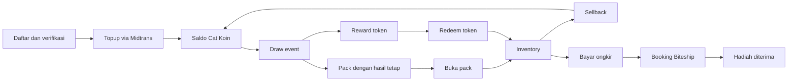
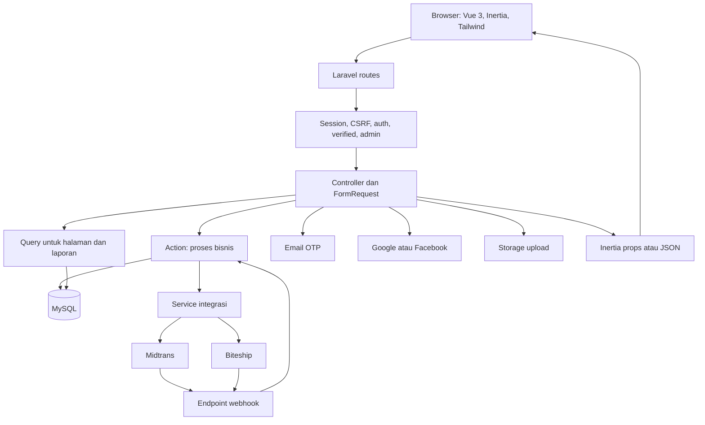
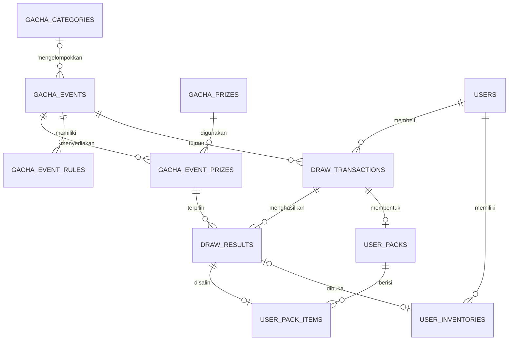
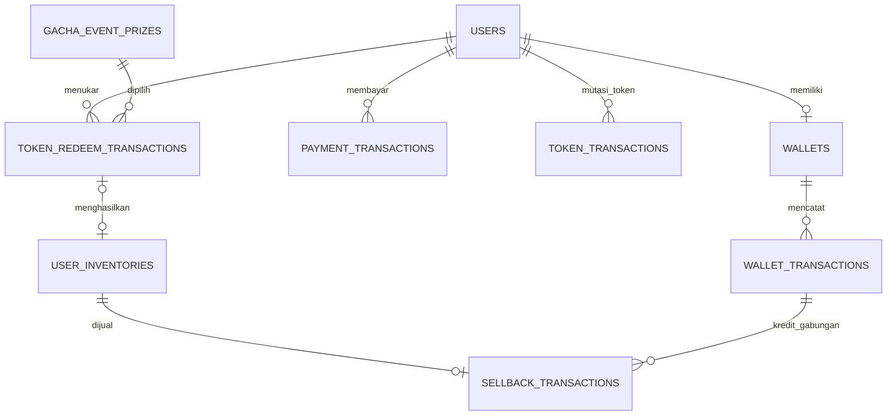
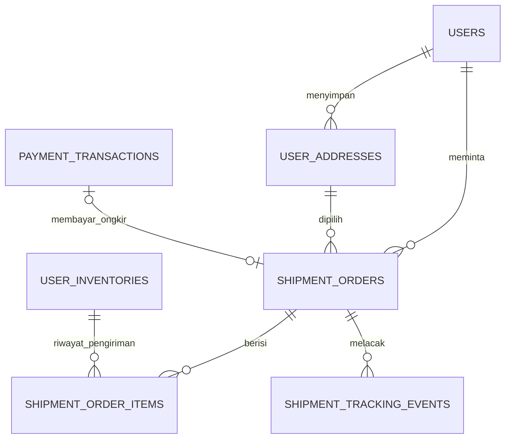
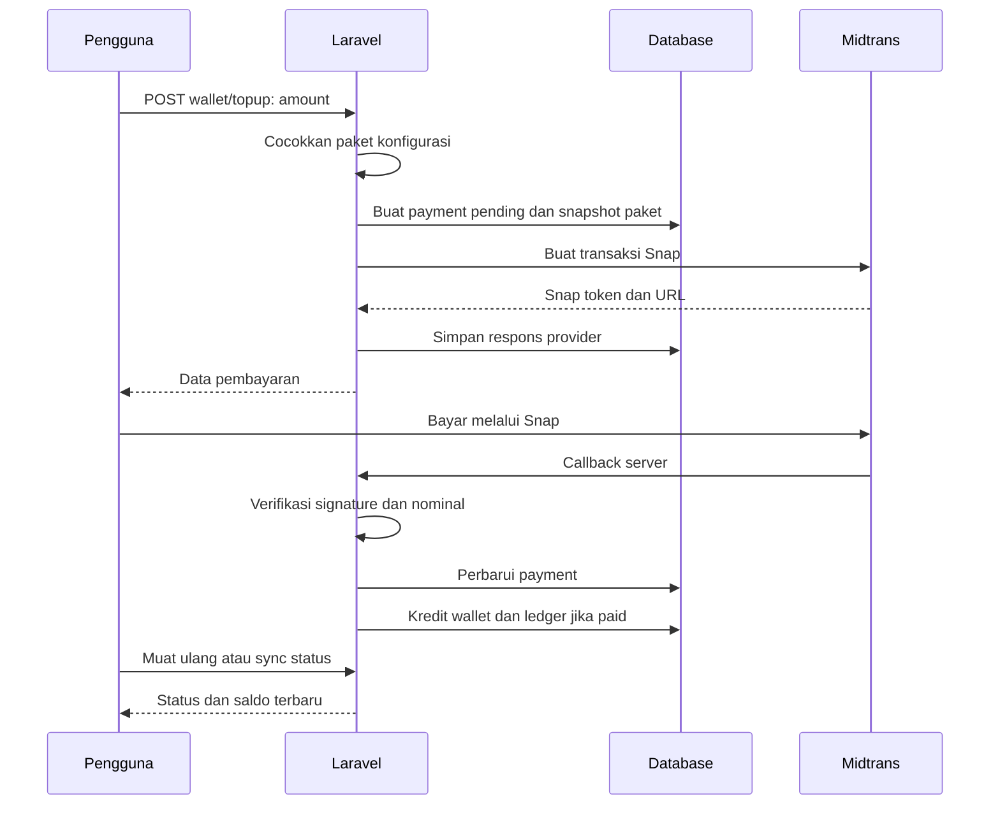

# Peta teknis proyek Catkuji

> Perbaikan diterapkan 24 September 2026: lihat [implementasi dan aktivasi deployment](PERBAIKAN-PASCA-AUDIT-2026-09-24.md). Hasil terbaru 58 tes lulus, 282 assertion. Temuan audit di bawah merupakan kondisi sebelum perbaikan.

> Pembaruan optimasi internal: query katalog/transaksi, batching sync, dan validasi serta deduplikasi webhook telah diperbaiki. Hasil terbaru: 48 tes lulus, 235 assertion. Lihat [daftar optimasi](OPTIMASI-INTERNAL-2026-09-23.md).

> Lanjutan pengiriman: [perubahan booking, rekonsiliasi, status, dan feedback](AUDIT-LANJUTAN-PENGIRIMAN-2026-09-23.md).

> Pembaruan 23 September 2026: perbaikan autentikasi, pembayaran, dependensi, migrasi, dan tes telah diterapkan. Lihat [audit dan daftar perubahan terbaru](AUDIT-DAN-PERBAIKAN-2026-09-23.md). Uraian bertanggal 17 September di bawah adalah snapshot sebelum perbaikan tersebut.

Disusun: 17 September 2026. Dasar: kode lokal, model, migrasi, route, dan konfigurasi runtime lokal yang dibaca pada tanggal tersebut.

Dokumen ini menjelaskan **implementasi saat ini**. Bagian bertanda **saran** atau **target** belum diterapkan. Daftar masalah keamanan merujuk ke [audit 15 September](../AUDIT-2026-09-15.md); rencana pengembangan ada di [Rencana penyempurnaan](RENCANA-PENYEMPURNAAN.md).

## 1. Gambaran bisnis dan istilah

Catkuji menghubungkan pembelian koin, pembelian draw, hasil hadiah, penyimpanan hadiah, penjualan kembali, dan pengiriman fisik.

| Istilah | Arti dalam proyek |
| --- | --- |
| Product / event | Produk di admin adalah `GachaEvent`: kumpulan hadiah dengan harga draw, periode, stok, dan kategori |
| Prize master | `GachaPrize`: identitas hadiah, gambar, tipe, harga referensi, dan ukuran/berat |
| Event prize | `GachaEventPrize`: penempatan hadiah pada event, termasuk bobot peluang dan stok |
| Cat Koin | Saldo pembelian draw; disimpan di `wallets.balance` |
| Token | Poin reward draw untuk ditukar dengan hadiah; disimpan di `users.token_balance` |
| Pack | Wadah hasil draw yang belum dibuka; hasilnya sudah ditentukan server |
| Inventory | Item individual milik pengguna yang sudah tersedia untuk tindakan berikutnya |
| Sellback | Menjual inventory kembali untuk memperoleh koin, bukan pencairan rupiah |
| Snapshot | Salinan atribut hadiah/alamat saat transaksi agar riwayat memiliki konteks |
| Ledger | Catatan perubahan saldo, misalnya `wallet_transactions` |
| Idempotensi | Mengulang permintaan yang sama menghasilkan efek bisnis satu kali |
| Row lock | Mengunci baris database selama transaksi agar penulisan bersamaan dapat diatur |

Alur bisnis utama:

Catatan: jalur kirim berlaku untuk hadiah fisik. Alur klaim digital/voucher belum lengkap di backend yang diperiksa.

## 2. Arsitektur aplikasi saat ini

Satu aplikasi Laravel menangani halaman, otorisasi, transaksi, database, dan integrasi eksternal. Vue menampilkan halaman melalui Inertia. Ini merupakan monolit dengan pemisahan sebagian logika ke kelas Action dan Service.

Diagram menunjukkan pembagian umum. Beberapa controller masih menjalankan transaksi bisnis langsung, misalnya pembukaan pack dan pengelolaan produk.

### Stack dan konfigurasi yang teramati

| Bagian | Implementasi / kondisi |
| --- | --- |
| Backend | PHP dengan requirement `^8.2`, Laravel `^12.0` pada composer.json |
| Antarmuka | Vue 3, Inertia 2, Vite, Tailwind 3; Flowbite, Bootstrap Icons, ApexCharts |
| Navigasi | Route Laravel; Ziggy menyediakan nama route kepada Vue |
| Database runtime lokal | MySQL; konfigurasi fallback repository adalah SQLite |
| Database test | SQLite `:memory:` menurut phpunit.xml; kendala migrasi dicatat dalam audit |
| Session / cache lokal | Driver file / file |
| Queue lokal | Driver database; konfigurasi worker saja tidak membuat proses otomatis menjadi background job |
| Storage | Default lokal adalah disk local; unggahan gambar secara eksplisit memakai disk public |
| Pembayaran | Midtrans Snap, callback, dan pengecekan status dari server |
| Pengiriman | Biteship rates, create order, status API, dan webhook |
| Login sosial | Laravel Socialite: Google dan Facebook |
| PDF | Dompdf untuk bukti topup |

Nilai di atas bukan bukti konfigurasi production. Credential, hostname database, dan secret tidak dimasukkan ke dokumentasi.

### Struktur folder dan tanggung jawab

| Lokasi | Peran |
| --- | --- |
| `routes/web.php` | Halaman pengguna, transaksi pengguna, callback pembayaran/pengiriman |
| `routes/auth.php` | Login, registrasi, OTP, reset password, OAuth |
| `routes/admin.php` | Dashboard, produk/kategori, laporan, banner, catatan, pengaturan admin |
| `bootstrap/app.php` | Middleware, proxy, pengecualian CSRF webhook |
| `app/Http/Controllers` | Penerimaan request, pengambilan data, pemanggilan bisnis, response |
| `app/Http/Requests` | Validasi beberapa input; sebagian validasi masih berada di controller |
| `app/Actions` | Draw, mutasi wallet/token, topup, sellback, pengiriman |
| `app/Services` | Klien provider, pemilihan hadiah, nomor transaksi |
| `app/Models` | Relasi Eloquent, casts, scopes, pemeriksaan sederhana |
| `app/Observers/UserObserver.php` | Pembuatan wallet saat user dibuat |
| `app/Console/Commands` | Command sinkronisasi shipment |
| `resources/js/Pages` | Halaman Vue pengguna dan admin |
| `resources/js/Components` | Kartu event, modal auth, transaksi, dan komponen lain |
| `resources/js/Utils` | Helper gambar, wishlist, dan auth modal |
| `database/migrations` | Evolusi struktur database |
| `database/seeders` | Data awal/demo; jangan digunakan sebagai mekanisme perbaikan data transaksi |

### Siklus satu request

1. Browser membuka route, misalnya `/events/{slug}`.
2. Laravel mencocokkan route dan mengambil model melalui route model binding.
3. Middleware memeriksa session/CSRF/akses sesuai grup route.
4. Controller mengambil data, atau menjalankan Action untuk mutasi.
5. Controller mengembalikan halaman Inertia, redirect dengan flash, atau JSON.
6. Vue menerima props dan merender halaman. Mutasi tertentu menggunakan JSON; form lain mengikuti redirect Inertia.

`HandleInertiaRequests` membagikan user, role/status, saldo koin/token, daftar ID wishlist, dan flash message. `resources/js/app.js` memasang modal auth global serta indikator loading. Informasi di browser adalah tampilan; perhitungan dan izin transaksi harus diputuskan ulang oleh server.

## 3. Skema data inti

ERD berikut memperlihatkan **hubungan logis utama**, bukan seluruh kolom atau jaminan constraint SQL. Kardinalitas satu-ke-satu yang diharapkan kode perlu dibedakan dari indeks unik yang benar-benar ada.

### 3.1 Katalog, draw, dan inventory

### 3.2 Saldo dan penukaran token

Referensi wallet/token ke transaksi sumber sebagian memakai pasangan `reference_type` dan `reference_id`; ini hubungan aplikasi, bukan foreign key ke satu tabel tetap.

### 3.3 Pengiriman

Relasi alamat dilengkapi snapshot penerima/alamat pada shipment. Perubahan alamat profil sesudah checkout seharusnya tidak mengubah alamat pesanan yang sudah dibuat.

### Kamus tabel bisnis

Kolom di bawah adalah kolom penting untuk memahami alur, bukan daftar SQL lengkap. Umumnya tabel memiliki `id`, `created_at`, dan `updated_at`.

| Tabel | Data penting | Fungsi dan aturan |
| --- | --- | --- |
| `users` | email, password hash, role, status, email_verified_at, token_balance, provider IDs | Identitas, akses, saldo token |
| `email_verification_codes` | user_id, email, code hash, expires_at, used_at | Penyimpanan OTP; perlu challenge dan batas percobaan |
| `user_addresses` | user_id, penerima, alamat, kode pos, is_default | Alamat milik pengguna |
| `wallets` | user_id, balance, locked_balance, currency, status | Satu wallet per pengguna melalui unique user_id; satuan COIN |
| `wallet_transactions` | wallet_id, type, category, amount, balance_before/after, reference | Ledger debit/kredit koin |
| `payment_transactions` | purpose, order_no, midtrans_order_id, gross_amount, status, payload JSON | Pembayaran rupiah topup atau ongkir |
| `gacha_categories` | name, slug, card_style, promo dates, is_archived, warna | Pengelompokan katalog dan desain kartu |
| `gacha_events` | category_id, price_per_draw, periode, status, stock_left/total, draw_mode | Penawaran draw; batas harian dan izin sellback/shipping |
| `gacha_prizes` | sku, slug, name, prize_type, image, market_price, sellback_price, dimensi | Master hadiah; dapat digunakan pada beberapa event |
| `gacha_event_prizes` | event/prize IDs, rarity, draw_weight, initial/current_stock, token_reward, redeem_stock | Konfigurasi hadiah per event; pasangan event-prize unik |
| `gacha_event_rules` | event_id, rule_type, konfigurasi, is_active | Struktur aturan tambahan tersedia; selector yang diperiksa belum membaca activeRules |
| `draw_transactions` | user/event IDs, draw_no, draw_count, total_cost, status, request_idempotency_key | Satu transaksi pembelian draw |
| `draw_results` | transaction/event/prize IDs, posisi, snapshot nama/gambar/harga/token | Hasil hadiah individual yang dipilih server |
| `user_packs` | user_id, draw_transaction_id, pack_no, pack_count, status | Pack unopened/opened; satu pack dibuat per eksekusi draw baru |
| `user_pack_items` | pack_id, draw_result_id, snapshot hadiah, revealed_at | Isi pack yang sudah ditentukan |
| `user_inventories` | user_id, draw_result_id atau token_redeem_transaction_id, status, sellback_price | Satu baris untuk satu hadiah; draw_result_id unik ketika terisi |
| `sellback_transactions` | inventory_id, wallet_transaction_id, amount, status | Satu penjualan per inventory, ditegakkan unique inventory_id |
| `token_transactions` | user_id, type, amount, balance_before/after, reference | Ledger token terpisah dari koin |
| `token_redeem_transactions` | user/event/prize IDs, redeem_no, token_cost, snapshots | Transaksi penukaran hadiah menggunakan token |
| `shipment_orders` | user/address/payment IDs, snapshot alamat, ongkir, kurir, status, external_order_id | Pesanan pengiriman fisik |
| `shipment_order_items` | shipment_id, inventory_id, qty, snapshot nama | Pemetaan item ke pengiriman; kode membuat qty 1 per inventory |
| `shipment_tracking_events` | shipment_id, status_code, description, source, event_time | Timeline perubahan shipment |
| `user_wishlists` | user_id, gacha_event_id | Favorit pengguna |
| `banners`, `admin_notes` | Konten dan metadata | Marketing dan catatan admin |
| `nps_feedbacks`, `csat_feedbacks` | user_id, skor/rating, teks, referensi terkait | Feedback pengguna dan laporan admin |
| `admin_audit_logs` | admin_id, action, target, before_json, after_json | Tabel/model tersedia; belum ditemukan pemanggilan pencatatan pada alur admin yang diperiksa |

Tabel infrastruktur terpisah meliputi sessions, password_reset_tokens, jobs, job_batches, failed_jobs, cache, dan cache_locks. Keberadaan tabel tidak berarti driver aktif menggunakannya; session lokal saat diperiksa memakai file.

### Satuan nilai: jangan dicampur

| Nilai | Satuan |
| --- | --- |
| `payment_transactions.gross_amount`, ongkir | Rupiah |
| `wallets.balance`, debit draw, kredit sellback | Koin |
| `users.token_balance`, token_reward, token_cost | Token |
| market_price | Harga referensi hadiah; samakan kontrak satuan di seluruh form/laporan sebelum perubahan |

`config/gacha.php` menetapkan kurs default 1 koin = Rp1.000 dan paket 10/20/50/100 koin. Kurs bisa diubah lewat konfigurasi, sedangkan beberapa frontend masih memakai angka 1.000 langsung. Konversi bukan bukti bahwa koin bisa diuangkan kembali.

## 4. Alur autentikasi dan akses

### Registrasi email saat ini

1. `RegisteredUserController` memvalidasi email, telepon, password, dan persetujuan syarat.
2. User dibuat; `UserObserver` membuat wallet kosong.
3. OTP acak enam digit di-hash, disimpan dengan masa berlaku sepuluh menit, lalu dikirim melalui notification email.
4. Flash session memicu modal verifikasi Vue.
5. Endpoint OTP memverifikasi akun dan membuat sesi login.

**Catatan audit:** cabang akun yang sudah terverifikasi pada langkah 5 saat ini memiliki bypass OTP. Status nonaktif dan kontrak verifikasi email juga perlu diperbaiki sebelum alur ini dianggap aman.

### Login dan admin

- Login email/password menggunakan `LoginRequest`, termasuk rate limit kegagalan login.
- Akun belum terverifikasi diarahkan ke OTP melalui modal.
- OAuth mencari pengguna lewat provider ID atau email, lalu login.
- Pendaftaran admin membuat akun `pending_admin` berstatus pending.
- Super admin dapat menyetujui perubahan role/status lewat pengaturan admin.
- Route pengguna sensitif menggunakan auth + verified; sebagian feedback hanya auth.
- Route admin utama memakai admin + verified. Route settings memakai super_admin secara terpisah; celah pemeriksaan status ada dalam audit.

**Target akses:** semua transaksi memerlukan sesi valid, akun aktif, email terverifikasi, dan kepemilikan resource. Hak admin perlu diperiksa pada backend untuk setiap tindakan, termasuk export dan retry/cancel shipment.

Sumber utama: [registrasi](../app/Http/Controllers/Auth/RegisteredUserController.php), [OTP](../app/Http/Controllers/Auth/EmailOtpVerificationController.php), [route admin](../routes/admin.php).

## 5. Alur topup: rupiah menjadi koin

`CreateTopupTransactionAction` menyimpan jumlah koin paket di metadata agar kredit menggunakan paket transaksi tersebut. Pembuatan Snap saat ini dilakukan di dalam transaksi database. Callback diterima oleh `PaymentController` lalu diproses oleh `HandleMidtransCallbackAction`.

Untuk topup paid, action membaca ulang payment dengan lock, memeriksa `wallet_credited`, menjalankan kredit wallet, dan menandai kredit. Ada unique reference ledger sebagai perlindungan tambahan. Pemeriksaan transisi status payment sebelum lock masih perlu diperbaiki.

**Aturan target:** tampilan sukses di browser tidak boleh menjadi dasar kredit. Kebenaran pembayaran harus berasal dari validasi notifikasi server/status provider. Provider dapat mengirim notifikasi berulang atau tidak berurutan; penanganannya harus idempoten. Lihat [panduan webhook Midtrans](https://docs.midtrans.com/docs/https-notification-webhooks).

Sumber: [topup](../app/Actions/Payment/CreateTopupTransactionAction.php), [callback](../app/Actions/Payment/HandleMidtransCallbackAction.php), [kredit wallet](../app/Actions/Wallet/CreditWalletAction.php).

## 6. Alur draw, peluang, pack, dan token reward

### Transaksi draw saat ini

1. Request membawa `draw_count` antara 1–10 dan `request_idempotency_key`.
2. Action membuka transaksi database dan mengunci event.
3. Jika user + event + key sudah memiliki transaksi, hasil lama dikembalikan.
4. Server memeriksa status/periode event, draw mode, stok, dan batas draw harian.
5. Total biaya dihitung `price_per_draw × draw_count`; field `price_per_multi_draw` belum dipakai dalam perhitungan action ini.
6. Dibuat draw transaction, lalu wallet dikunci dan didebit.
7. Dibuat satu pack unopened dan diambil daftar event prize yang masih memiliki stok dengan lock.
8. Untuk setiap draw, selector memilih hadiah berbobot, mengurangi stok prize dan event, membuat draw result, mengkredit reward token, dan membuat pack item.
9. Commit menyimpan keseluruhan perubahan. Kegagalan dalam transaksi membatalkan perubahan database tersebut.
10. Response berisi transaksi, saldo, pack, token, dan hasil hadiah.

### Cara peluang bekerja

Selector hanya memasukkan hadiah dengan `current_stock > 0` dan `draw_weight > 0`. Angka dipilih menggunakan `random_int(1, totalWeight)`.

Untuk kumpulan hadiah yang saat itu memenuhi syarat:

`P(hadiah i) = draw_weight_i / jumlah draw_weight seluruh hadiah yang tersedia`

Contoh: hadiah A berbobot 70 dan B berbobot 30 memberikan peluang 70% dan 30% meskipun stok A dan B berbeda. Saat B habis, peluang A menjadi 100%. Jadi stok menjadi syarat ketersediaan; stok bukan pengali bobot.

Label rarity tidak otomatis menentukan peluang. Tidak ditemukan pemakaian `gacha_event_rules` dalam selector saat ini. Jangan mengiklankan pity/guarantee sebelum aturan tersebut benar-benar diimplementasikan dan diuji.

### Membuka pack

- Server memeriksa pemilik pack, mengunci pack, dan memeriksa ulang status unopened.
- Setiap pack item dibuat menjadi inventory melalui `firstOrCreate(draw_result_id)`.
- Pack berubah menjadi opened dan item mendapat `revealed_at`.
- Tidak ada pengundian ulang atau pengkreditan token baru saat membuka pack.

**Implikasi produk:** hasil sudah disimpan dan dikirim saat draw, jadi animasi buka pack adalah presentasi hasil. Jika hasil ingin dirahasiakan sampai buka pack, kontrak response draw harus diubah; menyembunyikannya di Vue saja tidak cukup.

Sumber: [draw](../app/Actions/Gacha/ExecuteDrawAction.php), [selector](../app/Services/Gacha/PrizeSelectorService.php), [buka pack](../app/Http/Controllers/Web/InventoryPackController.php).

## 7. Inventory, sellback, dan redeem token

### Sellback

1. Pengguna memilih jenis hadiah dan jumlah untuk preview/checkout.
2. Action mengambil inventory milik pengguna dengan status stored dan sellback_price positif, urut ID, lalu menguncinya.
3. Nilai kredit dihitung dari inventory aktual yang dipilih server.
4. Satu kredit wallet gabungan dibuat; setiap inventory mendapat sellback transaction.
5. Inventory berubah menjadi sellbacked dalam transaksi database yang sama.

**Catatan:** aturan sellback_enabled milik event belum ditegakkan oleh action ini. Saat admin mengedit harga sellback, controller saat ini juga memperbarui inventory stored, pack item, dan snapshot draw result terkait. Karena itu snapshot harga belum sepenuhnya merupakan riwayat yang tidak berubah.

### Redeem token

1. Server mengunci event prize dan user.
2. Memeriksa flag redeem, harga token positif, redeem stock, event published, dan saldo token.
3. Membuat token redeem transaction dan ledger debit token.
4. Mengurangi `users.token_balance` dan `redeem_stock_left`.
5. Membuat inventory langsung berstatus stored, tanpa pack.

**Perbedaan penting:** redeem hanya memeriksa status published pada event, sedangkan draw memeriksa periode melalui `isActive()`. Stok redeem terpisah dari stok draw. Kebijakan apakah keduanya mengambil barang dari gudang fisik yang sama perlu ditentukan.

Sumber: [sellback](../app/Actions/Inventory/BulkSellbackInventoryAction.php), [redeem](../app/Actions/Token/RedeemTokenPrizeAction.php).

## 8. Alur pengiriman fisik

1. Inventory dipilih, lalu preview disimpan dalam session.
2. Pengguna memilih alamat, kurir, dan layanan.
3. Saat checkout, backend meminta ulang tarif Biteship dan memilih tarif berdasarkan kode kurir/layanan. Nominal ongkir tidak langsung dipercayakan kepada browser.
4. `CreateShipmentOrderAction` memeriksa alamat, kepemilikan inventory, duplikasi ID, status stored, dan tipe physical di bawah transaksi/lock.
5. Dibuat shipment pending_payment dengan snapshot alamat dan shipment items. Inventory menjadi shipping_pending_payment.
6. Action pembayaran ongkir membuat payment Midtrans dengan purpose shipping.
7. Setelah callback paid, shipment ditandai paid dan booking Biteship dijalankan.
8. Response booking menyimpan ID eksternal dan nomor resi bila tersedia.
9. Webhook atau command sync memperbarui shipment, inventory, dan tracking events.
10. Admin mempunyai route retry booking dan cancel dengan pembatasan kondisi tertentu.

Status yang digunakan implementasi:

| Tahap | Status shipment | Status inventory |
| --- | --- | --- |
| Checkout ongkir | pending_payment | shipping_pending_payment |
| Pembayaran diterima | paid | shipping_requested |
| Diproses kurir | processing | shipping_requested |
| Dikemas | packed | shipping_requested |
| Dalam pengiriman | shipped | shipped |
| Sampai | delivered | delivered |
| Booking/status eksternal gagal | booking_failed | Tidak diubah oleh normalizer kegagalan |
| Pembatalan admin yang diizinkan | cancelled | Item eligible dikembalikan ke stored |

Ini daftar pemetaan implementasi, bukan state machine yang menjamin urutan. Saat ini normalizer juga memetakan status cancelled dari provider menjadi booking_failed. Perlu pemisahan dan aturan transisi yang eksplisit.

Command `shipments:sync-pending` sudah tersedia untuk shipment yang memiliki external_order_id dan status tertentu. Belum ditemukan pendaftaran jadwalnya di `routes/console.php`; keberadaan cron eksternal belum diperiksa.

Sumber: [checkout](../app/Http/Controllers/Web/ShipmentController.php), [buat shipment](../app/Actions/Shipment/CreateShipmentOrderAction.php), [sinkronisasi](../app/Actions/Shipment/SyncShipmentStatusAction.php), [command sync](../app/Console/Commands/SyncPendingShipments.php).

## 9. Admin, katalog, laporan, dan fitur pendukung

| Modul | Implementasi utama | Batasan penting |
| --- | --- | --- |
| Katalog homepage | Kategori aktif, banner aktif, event published; empat event untuk kategori standard | Kueri event dilakukan per kategori; kategori promo tidak diberi limit yang sama |
| Event detail | Data event, hadiah, stok, dan opsi draw | Status tampil dan kelayakan transaksi perlu memakai kebijakan yang konsisten |
| Form produk | Nama, harga, periode, kategori, hadiah, stok, bobot, token/redeem | Controller besar; banyak aturan berbeda dalam satu alur |
| Stok event | Saat update, dijumlah dari event prize dengan sort_order di bawah 999999 | Angka sort_order juga dipakai sebagai penanda hadiah dihapus; perlu status eksplisit |
| Kategori | Urutan, gaya kartu, warna, periode promo, arsip | Promo kedaluwarsa diarsipkan saat membaca halaman; produk masih bisa menunjuk kategori arsip |
| Transaksi pengguna | Menggabungkan topup, purchase, sellback, shipment menjadi collection | Penggabungan/filter dalam memori perlu pagination saat data tumbuh |
| Dashboard dan export | Controller admin untuk produk, order, user, pembayaran | Definisi angka omzet/topup/spend/refund harus dibedakan |
| Wishlist | Relasi pengguna-event dan helper frontend | Seluruh ID wishlist dibagikan melalui props global |
| Feedback | NPS dan CSAT, termasuk laporan admin | Tetapkan apakah feedback per user atau per transaksi; cek kepemilikan shipment saat ditautkan |
| Digital/voucher | Tipe hadiah dan sebagian tampilan tersedia | `TransactionController` masih memakai collection kosong untuk digital claims; halaman voucher belum menyediakan ledger voucher |

## 10. File, background process, dan batas operasional

- File upload tersimpan pada `storage/app/public`; web mengaksesnya melalui `public/storage`. Tautan ini harus dibuat untuk lokasi deployment yang benar.
- Aset yang diimpor Vue diproses Vite; ini berbeda dari gambar hadiah yang diunggah admin.
- Helper URL gambar tersebar di controller dan Utils. Standardisasi akan mengurangi inkonsistensi path dan fallback.
- Notification OTP memakai trait Queueable tetapi tidak mengimplementasikan ShouldQueue; pengiriman saat ini berlangsung pada request pemanggil.
- Action Snap dan booking Biteship saat ini memanggil provider secara langsung. Belum ditemukan folder job aplikasi untuk proses tersebut.
- Driver queue database sudah tersedia; worker, penjadwalan, retry, dan monitoring perlu dirancang sebagai satu alur.
- Banyak relasi transaksi menggunakan cascade delete. Sebelum mengubah kebijakan hapus user/event/prize, petakan dampak terhadap riwayat dan proses rekonsiliasi.

## 11. Aturan integritas yang disarankan sebagai kontrak

Daftar berikut adalah **target pengujian**, bukan klaim semua sudah terpenuhi:

1. Satu identitas transaksi topup yang valid menghasilkan satu kredit koin.
2. Saldo akhir sama dengan saldo awal ditambah kredit dikurangi debit; saldo tidak negatif.
3. Jumlah draw result sama dengan draw_count; jumlah pack item cocok dengan hasilnya.
4. Stok hanya turun untuk draw/redeem yang berhasil commit.
5. Membuka pack berulang tidak menambah inventory atau token.
6. Satu inventory tidak bisa dijual dan dikirim bersamaan.
7. Hanya satu proses booking aktif per shipment; timeout tidak langsung dianggap gagal di sisi provider.
8. Status terminal tidak diturunkan oleh notifikasi lama; refund dan retur menjadi proses terpisah.
9. Snapshot transaksi yang disepakati tetap historis; perubahan master hadiah tidak diam-diam menulis ulang riwayat.
10. Kategori, event, dan prize memiliki kebijakan aktif/arsip yang sama untuk tampilan dan transaksi.
11. Setiap mutasi admin yang memengaruhi akses, stok, harga, atau transaksi dapat ditelusuri.
12. Nilai rupiah, koin, dan token mempunyai unit eksplisit dalam API, database, serta laporan.

Lanjutkan ke [rencana penyempurnaan dan keputusan bisnis](RENCANA-PENYEMPURNAAN.md) untuk desain target dan prioritas implementasi.
